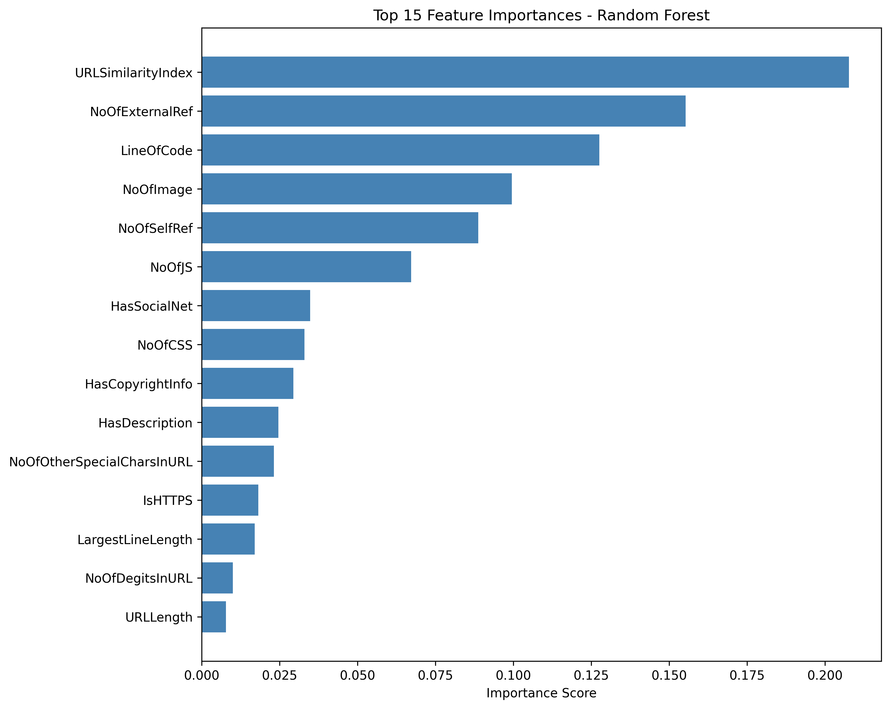

# PhishChecker

**Classifying phishing URLs with machine learning: three models, tuned and compared on 235,795 real URLs.**


## What it does

A reproducible training and evaluation pipeline on the [PhiUSIIL Phishing URL dataset](https://archive.ics.uci.edu/dataset/967/phiusiil+phishing+url+dataset) (UCI). Each row describes a URL and the page behind it with 50 numeric features, such as URL length, obfuscated characters, subdomain count, HTTPS, redirects, iframes, password fields and external form submissions.

```
load CSV → drop text columns → standardize → 80/20 split
        → GridSearchCV (5-fold, weighted F1) for each model
        → metrics table, confusion matrices, ROC curves, feature importances
```

## Results

| Model | Accuracy | Precision | Recall | F1 |
|---|---|---|---|---|
| Logistic Regression | 0.9999 | 0.9999 | 0.9999 | 0.9999 |
| Random Forest | 1.0000 | 1.0000 | 1.0000 | 1.0000 |
| XGBoost | 1.0000 | 1.0000 | 1.0000 | 1.0000 |

Near-perfect scores on every model are a signal worth questioning rather than celebrating. The feature-importance plots show a few engineered features (like `URLSimilarityIndex`) doing most of the work, and those features were computed with knowledge of known-legitimate URLs. The next step is an ablation run without them to see how well the models do on raw URL and page structure alone.

<p align="center"></p>

More plots (confusion matrices, ROC curves) are in [`backend/report/`](backend/report/).

## Run it

```bash
cd backend
pip install -r requirements.txt
python phish_detector.py
```

The dataset CSV is expected at `backend/data/PhiUSIIL_Phishing_URL_Dataset.csv`.

## Structure

```
backend/
  phish_detector.py     Entry point: runs the full pipeline
  src/data_loader.py    Loads the dataset
  src/preprocess.py     Drops text columns, scales features
  src/model_training.py GridSearchCV for Logistic Regression, Random Forest, XGBoost
  src/evaluate.py       Metrics, confusion matrices, ROC curves, feature importances
  report/               Generated results and plots
```
